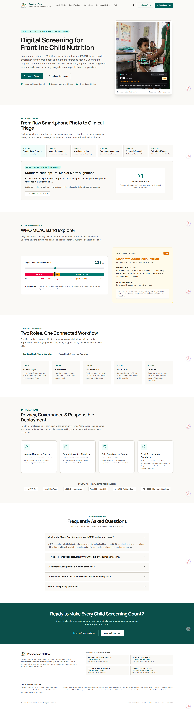

# PoshanScan



PoshanScan is an end-to-end smartphone-assisted MUAC screening platform. A
frontline worker registers a person, captures an arm photo beside a printed
ArUco reference marker, and receives a category-specific MUAC estimate. The
supervisor portal then provides real screening data, trends, flagged cases,
worker activity, reports, and GPS-backed location surveillance.

> PoshanScan is a screening aid, not a medical diagnosis. Suspected cases must
> be confirmed by a trained health worker using standard clinical assessment
> and a MUAC tape.

## Architecture

```text
                         +----------------------+
                         |  React/Vite frontend |
                         |  Worker + Supervisor |
                         +----------+-----------+
                                    |
                              HTTP + JWT
                                    |
                         +----------v-----------+
                         |   FastAPI backend    |
                         | Auth, scans, reports |
                         +-----+-----------+----+
                               |           |
                         SQLAlchemy     HTTP /infer
                               |           |
                    +----------v--+   +----v-----------+
                    | PostgreSQL  |   | FastAPI ML/CV  |
                    | / Supabase  |   | OpenCV + Pose |
                    +-------------+   +----------------+
```

### Repository layout

```text
poshanscan/
├── frontend/       React 19, TypeScript, Vite, TanStack Router/Query
├── backend/        FastAPI, SQLAlchemy, JWT authentication, PostgreSQL
├── ml-service/     FastAPI, OpenCV, ArUco, MediaPipe, segmentation, MUAC
└── README.md
```

### Runtime flow

1. The worker signs in and selects a child or adult screening category.
2. The worker captures one guided photo containing the arm and 50 mm ArUco
   marker.
3. The backend validates the request, stores the photo, and calls the ML
   service.
4. The ML service detects the marker scale, localizes the arm, segments the
   measurement region, estimates MUAC, and classifies the risk band.
5. The backend stores the scan, category, confidence, GPS coordinates, and
   image metadata.
6. Supervisors review category-filtered dashboards, flagged scans, maps, and
   reports.

## Supported screening categories

| Category | Classification |
|---|---|
| `child_6_59m` | SAM `<115 mm`, MAM `115–<125 mm`, Normal `≥125 mm` |
| `adult` | Severe `<210 mm`, Moderate `210–<230 mm`, Normal `≥230 mm` |

Children and adults are stored, queried, visualized, and exported separately.
Adolescent screening is intentionally not supported because this MUAC-only
workflow does not collect the age and sex data required for an appropriate
reference standard.

## Prerequisites

- Windows PowerShell, macOS Terminal, or Linux shell
- Python 3.10 or newer
- Node.js 18 or newer and npm
- PostgreSQL/Supabase access for the configured database
- A printed 50 mm `DICT_4X4_50` ArUco marker for live inference

## Local configuration

Runtime environment files are intentionally local and are not documented with
credentials:

- Backend: `backend/.env`
- Frontend: `frontend/.env`
- ML service: uses its Python defaults unless overridden

The backend `.env` contains the working URL-encoded database connection and
points to the local ML service. If you use another
database, update `DATABASE_URL` and restart the backend.

Frontend configuration:

```text
VITE_API_BASE_URL=http://127.0.0.1:8000
VITE_REFERENCE_TYPE=aruco
VITE_REFERENCE_SIZE_MM=50
VITE_MIN_SHARPNESS=40
VITE_MAP_API_KEY=<optional-map-provider-key>
VITE_MAP_PROVIDER=maptiler
```

Do not commit real passwords, JWT secrets, Supabase keys, or third-party API
keys. Use local environment files or your deployment platform's secret store.

## Run locally

Open three PowerShell terminals from `D:\minor project complete\poshanscan`.

### 1. Start the ML/CV service

```powershell
cd ml-service
python -m pip install -r requirements.txt
python -m uvicorn app.main:app --reload --host 127.0.0.1 --port 8001
```

Health check: `http://127.0.0.1:8001/health`

### 2. Start the backend

```powershell
cd backend
python -m pip install -r requirements.txt
python -m uvicorn app.main:app --reload --host 127.0.0.1 --port 8000
```

Backend API docs: `http://127.0.0.1:8000/docs`

The backend applies database migrations during startup. The database is not
reset by normal startup. Use the project's explicit maintenance/reset process
only when a fresh dataset is intended.

For isolated backend tests, the test suite replaces CV calls with deterministic test responses:

```powershell
pytest -q
```

### 3. Start the frontend

```powershell
cd frontend
npm install
npm run dev
```

Open `http://localhost:5173`.

## Main application areas

### Worker application

- Worker login and profile details
- Child/adult registration and category-specific search
- One scan per person and category, with duplicate protection
- Guided photo capture with sharpness/reference checks
- Browser GPS capture when permission is granted
- Scan result, risk band, image report, and rescan status
- Offline sync support through the backend sync endpoint

### Supervisor portal

- Fresh supervisor/admin login on every portal entry
- Overview KPIs and category switcher
- Trends with real database data
- Locations map using recorded scan or registered location coordinates
- Worker activity and screening volume
- Flagged/reviewed scan workbench with report images
- Category-filtered CSV export and printable programme summary
- Session expiry, logout, query-cache clearing, and unauthorized-session handling

## API overview

### Authentication

- `POST /auth/login`
- `POST /supervisor/login`
- `POST /auth/signup`
- `GET /auth/me`

### Worker and scan operations

- `GET /children/search`
- `GET /children/{child_id}/scan-status`
- `POST /children`
- `POST /scans`
- `GET /scans/{scan_id}`
- `POST /sync`

### Supervisor dashboard

- `GET /supervisor/dashboard/overview`
- `GET /supervisor/dashboard/trends`
- `GET /supervisor/dashboard/locations`
- `GET /supervisor/dashboard/workers`
- `GET /supervisor/dashboard/flagged`
- `POST /supervisor/dashboard/flagged/{scan_id}/review`
- `GET /supervisor/dashboard/export`

Dashboard endpoints accept `age_category=child_6_59m`, `adult`, or `all`
where applicable. The CSV export uses the selected age category as well.

### ML service

- `GET /health`
- `POST /infer`

`/infer` accepts an image, `age_category`, `reference_type`, and
`reference_size_mm`. It returns a structured success result or a clear
capture/inference error such as missing marker, missing arm, or an
age-specific out-of-range measurement.

## Testing and quality checks

Run the focused suites from each service directory:

```powershell
cd frontend
npm test -- --run
npm run build

cd ..\backend
pytest -q

cd ..\ml-service
pytest -q
```

The current verified suites cover:

- Frontend: 39 tests
- Backend: 37 tests
- ML service: 48 tests

## Troubleshooting

### Frontend cannot reach the backend

Confirm the backend is running on port `8000` and that
`frontend/.env` contains:

```text
VITE_API_BASE_URL=http://127.0.0.1:8000
```

Restart Vite after changing environment variables.

### Live scan fails

Confirm both services are running and that `backend/.env` contains:

```text
CV_SERVICE_URL=http://127.0.0.1:8001
```

Use the 50 mm marker, keep the full upper arm visible, and grant browser
location permission if map coordinates are required.

### Database connection fails

Check `DATABASE_URL`, URL-encode special characters in the password, verify
the Supabase/PostgreSQL project is reachable, and restart the backend.

### Supervisor dashboard shows an expired session

Use the supervisor login route again. The portal clears its persisted
supervisor session and React Query cache when the login screen opens.

## Service documentation

- [Frontend README](frontend/README.md)
- [Backend README](backend/README.md)
- [ML service README](ml-service/README.md)

## Important safety and privacy notes

- Do not use the generated MUAC estimate as a standalone diagnosis.
- Confirm SAM/MAM results with a trained health worker and standard tape
  measurement.
- Treat child photos, worker profiles, GPS coordinates, and database
  credentials as sensitive data.
- Keep `.env` files and uploaded images out of source control and production
  logs.
