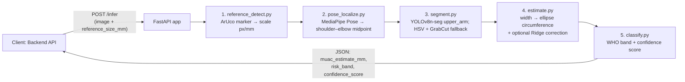
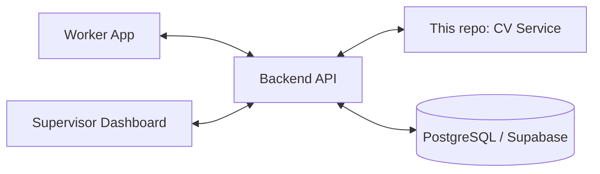

# PoshanScan CV Service

**AI-assisted Mid-Upper Arm Circumference (MUAC) estimation from a single smartphone photo.**

This microservice is the computer-vision engine behind [PoshanScan](https://github.com/poshanscan) — it takes a photo of a child's upper arm captured next to a printed reference marker, and returns an estimated MUAC measurement, a WHO screening band (Normal / MAM / SAM), and a confidence score. It exists to assist — not replace — manual MUAC tape screening used by frontline health workers to detect acute child malnutrition.

🟢 **Live:** `https://poshanscan-ml-cv-service.onrender.com` · Interactive API docs: [`/docs`](https://poshanscan-ml-cv-service.onrender.com/docs)

> Free-tier hosting spins down after inactivity — the first request after a while may take 30–60 seconds to wake up.

---

## What it does

```
 1. Photo in (arm + ArUco marker)
          │
          ▼
 2. Detect the marker  →  real-world scale (px per mm)
          │
          ▼
 3. Locate shoulder–elbow midpoint  →  the MUAC measurement site
          │
          ▼
 4. Segment the arm from the background
          │
          ▼
 5. Measure arm width  →  convert to an estimated circumference
          │
          ▼
 6. Classify: Normal / MAM / SAM  +  confidence score
          │
          ▼
 7. Structured JSON out
```

No step is a black box — every stage is a plain, inspectable function with its own confidence signal, and the service returns a clean, typed error (never a raw crash) if any stage fails.

---

## Live demo


The deployed service's interactive API docs at [`/docs`](https://poshanscan-ml-cv-service.onrender.com/docs), showing a real `POST /infer` call against the hosted pipeline and its JSON response.

---

## Architecture



This service is one of four independent repositories in the PoshanScan system (CV service, backend API, worker app, supervisor dashboard), each developed and deployed separately and connected only through REST APIs.



---

## API Reference

### `GET /health`
Liveness check.
```json
{ "status": "ok" }
```

### `POST /infer`
Runs the full MUAC pipeline on an uploaded image.

**Request** — `multipart/form-data`

| Field | Type | Required | Default | Description |
|---|---|---|---|---|
| `image` | file | ✅ | — | Photo of the upper arm with a reference marker in frame |
| `age_category` | string | ✅ | — | Either `"child_6_59m"` (WHO 6–59 month paediatric screening) or `"adult"` (adult/maternal MUAC scale). **No other value is accepted.** |
| `reference_type` | string | ❌ | `aruco` | Reference object type (currently only `aruco` is implemented) |
| `reference_size_mm` | number | ❌ | `50` | Printed marker edge length, in millimetres |

```bash
curl -X POST https://poshanscan-ml-cv-service.onrender.com/infer \
  -H "accept: application/json" \
  -F "image=@arm_photo.jpg;type=image/jpeg" \
  -F "age_category=child_6_59m" \
  -F "reference_type=aruco" \
  -F "reference_size_mm=50"
```

**Response — `200 OK`**
```json
{
  "muac_estimate_mm": 118.6,
  "risk_band": "MAM",
  "age_category": "child_6_59m",
  "confidence_score": 0.87,
  "quality_flags": {
    "reference_detected": true,
    "arm_detected": true,
    "segmentation_ok": true
  },
  "pipeline_version": "v1.0"
}
```

| Field | Meaning |
|---|---|
| `risk_band` | Classification band. For `child_6_59m`: `"Normal"`, `"MAM"`, `"SAM"`. For `adult`: `"Normal"`, `"Moderate"`, `"Severe"` |
| `age_category` | The category applied — `"child_6_59m"` or `"adult"` — echoed back so the response is self-documenting |
| `confidence_score` | `0.0`–`1.0`, a weighted combination of marker, pose, and segmentation confidence (§ below) |
| `quality_flags` | Per-stage pass/fail, useful for debugging a low-confidence result |

**Response — `422 Unprocessable Entity`** (bad capture — the client should prompt a retake)
```json
{ "error": "age_category_required", "message": "age_category must be specified as 'child_6_59m' or 'adult'." }
```
or
```json
{ "error": "reference_object_not_detected", "message": "No ArUco reference marker was found in the image." }
```
or
```json
{ "error": "arm_not_detected", "message": "Could not localise a shoulder\u2013elbow pair for MUAC measurement." }
```
or
```json
{ "error": "measurement_out_of_range", "message": "The measured MUAC is outside the valid age-specific range. Retake the photo with the full arm and marker visible." }
```

**Response — `500 Internal Server Error`** — any unexpected failure, returned as a structured error rather than a raw stack trace.

Full interactive schema, including the `Body_infer_infer_post`, `InferResponse`, `ErrorResponse`, `HealthResponse`, and `QualityFlags` models, is available at [`/docs`](https://poshanscan-ml-cv-service.onrender.com/docs).

### Why only two `age_category` values?

MUAC cutoffs are not universal — they are calibrated against age- and sex-specific population references, and using the wrong scale can silently misclassify someone as normal when they are malnourished, or flag a false alarm.

- **`child_6_59m`** uses the WHO community-screening cutoffs (SAM < 115 mm, MAM 115–124.9 mm, Normal ≥ 125 mm) from the 2009 WHO guidance on community-based management of SAM. These are the globally accepted field thresholds for that age window.
- **`adult`** uses the published adult/maternal MUAC screening scale (Severe < 210 mm, Moderate 210–229 mm, Normal ≥ 230 mm), calibrated against BMI < 16.5 kg/m² and < 18.5 kg/m² respectively (Ferro-Luzzi & James 1996; Collins et al. 2000). This scale is used in MSF/UNHCR field nutrition protocols for adults and pregnant/lactating women.
- **Ages 5–19 years are explicitly not supported.** No single globally standardised MUAC-only cutoff exists for the 5–19 year bracket. WHO recommends BMI-for-age z-scores (BAZ) for that range, which requires sex and precise age — neither of which this system collects. Accepting an ambiguous "adolescent" category and applying either child or adult cutoffs would produce unsafe results, so the API rejects all values other than `"child_6_59m"` and `"adult"` with a clear error.

---

## How the pipeline works

### 1. Reference-marker detection & scale calibration — `reference_detect.py`
Detects a printed ArUco marker (`DICT_4X4_50`, OpenCV's `aruco` module) placed beside the arm. The mean of the marker's four detected side lengths (in pixels) is divided by its known physical size to get a scale factor:

```
scale (px/mm) = mean(side1, side2, side3, side4) / marker_size_mm
```

A confidence proxy is computed as *shortest side ÷ longest side* — a front-parallel marker has four near-equal sides (confidence ≈ 1); heavy perspective distortion lowers it. No marker found → `reference_object_not_detected`, no further processing.

### 2. Arm localisation — `pose_localize.py`
Uses **MediaPipe Pose** to find the shoulder and elbow landmarks (left side tried first, falling back to right). Their pixel midpoint is the MUAC measurement site — the same anatomical point a health worker locates manually with the shoulder-to-elbow method:

```
midpoint = ((x_shoulder + x_elbow) / 2, (y_shoulder + y_elbow) / 2)
```

Confidence is the mean of MediaPipe's own landmark visibility scores; below `0.3` the stage reports `arm_not_detected` rather than returning an unreliable point.

### 3. Arm segmentation — `segment.py`
The service loads the trained YOLOv8n-seg checkpoint for the single `upper_arm` class once at startup, when the pinned optional segmentation dependencies are available. It preserves the source image dimensions when returning the mask and falls back to the existing OpenCV HSV + GrabCut segmenter if the checkpoint or YOLO runtime cannot load. This fallback does not verify the YOLO model and should be identified when interpreting validation results.

### 4. MUAC estimation — `estimate.py`
Width is measured in pixels, converted to millimetres using the scale from step 1, then modelled as the circumference of an ellipse:

```
width_mm  = width_px / scale
MUAC_mm  ≈ π × k × width_mm      (k = 1.28 by default)
```

An optional `CalibrationCorrector` (Ridge regression, scikit-learn) can be trained on paired (camera estimate, tape measurement) data to correct systematic error. Until trained, it's a pass-through — the geometric estimate is returned unchanged, so the pipeline is fully runnable before any calibration data exists.

The detected ArUco marker is removed from the segmentation mask before measuring the arm. It must not be counted as foreground, because a 50 mm marker itself can otherwise inflate the estimated circumference to approximately 200 mm. Plausibility gates are applied separately: `70–180 mm` for `child_6_59m` and `100–450 mm` for `adult`; an out-of-range result requests a retake instead of saving a misleading measurement.

### 5. Classification & confidence — `classify.py`
```
< 115 mm            →  SAM   (Severe Acute Malnutrition)
115 mm – < 125 mm   →  MAM   (Moderate Acute Malnutrition)
≥ 125 mm             →  Normal
```
Overall confidence = `0.40 × reference_confidence + 0.35 × pose_confidence + 0.25 × segmentation_quality`.

---

## Project structure

```
poshanscan-ml-cv-service/
├── app/
│   ├── main.py                    # FastAPI app — /infer, /health
│   ├── schemas.py                 # Pydantic request/response models
│   └── pipeline/
│       ├── reference_detect.py    # ArUco detection + scale calibration
│       ├── pose_localize.py       # MediaPipe Pose → MUAC midpoint
│       ├── segment.py             # YOLO upper_arm segmentation + legacy fallback
│       ├── estimate.py            # Ellipse model + CalibrationCorrector
│       └── classify.py            # WHO bands + confidence scoring
├── scripts/
│   ├── generate_aruco_marker.py   # Print-ready ArUco marker generator
│   └── evaluate.py                # Offline accuracy evaluation (MAE/RMSE/bias/band-agreement)
├── tests/                         # pytest suite (5 files, 346 lines)
├── sample_images/
├── requirements.txt
├── Dockerfile
└── README.md
```

---

## Running locally

```powershell
cd "D:\minor project complete\poshanscan\ml-service"
if (!(Test-Path .venv\Scripts\python.exe)) {
  $python312 = Join-Path $env:LOCALAPPDATA "Programs\Python\Python312\python.exe"
  & $python312 -m venv .venv
}
.\.venv\Scripts\Activate.ps1
python -m pip install -r requirements.txt
python -m pip install -r requirements-segmentation.txt
$env:POSHANSCAN_SEGMENTATION_MODEL = "yolo"
python -m uvicorn app.main:app --host 127.0.0.1 --port 8001
```

Visit `http://localhost:8001/docs` for the interactive Swagger UI, or test directly:

```bash
curl -X POST http://localhost:8001/infer \
  -F "image=@sample_images/aruco_4x4_50_id0.png" \
  -F "reference_type=aruco" \
  -F "reference_size_mm=50"
```

To generate a printable test marker:
```bash
python scripts/generate_aruco_marker.py
```

---

## Testing

```bash
pytest
```

| Test file | Covers |
|---|---|
| `test_reference_detect.py` | ArUco detection and scale computation on synthetically generated markers; graceful handling of empty/invalid images |
| `test_pose_segment.py` | Pose localisation and the HSV+GrabCut segmentation baseline |
| `test_estimate_classify.py` | MUAC formula correctness; WHO band boundaries (114.9 / 124.9 / 125 mm); `CalibrationCorrector` pass-through behaviour |
| `test_api.py` | `/infer` success and structured-error paths; `/health` |
| `test_evaluate.py` | Correctness of the offline MAE/RMSE/bias/band-agreement computation |

### Measuring real-world accuracy

```bash
python scripts/evaluate.py --csv data/eval.csv --output results/eval.csv

# Compare against a trained calibration correction
python scripts/evaluate.py --csv data/eval.csv --with-correction \
  --model app/models/calibration.joblib --output results/eval_corrected.csv
```
`data/eval.csv` needs columns: `image_path, reference_size_mm, tape_measurement_mm, age_category`. The `age_category` column must be `child_6_59m` or `adult` for each row; rows with any other value are skipped with an error. Reports MAE, RMSE, signed bias, and WHO screening-band agreement against manual tape measurement — the ground truth this system is evaluated against, never assumed.

---

## Tech stack

| Purpose | Tool |
|---|---|
| API | FastAPI, Uvicorn |
| Marker detection | OpenCV (`cv2.aruco`, `DICT_4X4_50`) |
| Pose estimation | MediaPipe Pose |
| Segmentation | Ultralytics YOLOv8n-seg (`upper_arm`); OpenCV HSV + GrabCut fallback |
| Calibration correction | scikit-learn (Ridge regression), joblib |
| Testing | pytest |
| Hosting | Render (free tier, Docker) |

---

## Deployment

The Dockerfile always installs the pinned YOLO runtime and validates the
integrated checkpoint during image build. The production Render service uses
this Dockerfile directly, so it cannot silently build without segmentation
dependencies. The checkpoint is `app/models/arm_segmentation/best.pt`; its
expected SHA-256 is recorded in `app/models/arm_segmentation/best.pt.sha256`.
The checkpoint is not modified by the training workflow. `POSHANSCAN_SEGMENTATION_MODEL`
and `POSHANSCAN_SEGMENTATION_WEIGHTS` can select the inference mode and weights;
the remaining threshold settings are documented below.

---

## Known limitations & roadmap

- **A trained arm checkpoint is integrated.** Real-photo accuracy and tape-comparison results are not established by checkpoint existence or synthetic/unit tests; empirical validation remains pending until real photographs and manual tape references are evaluated.
- **The elliptical circumference model is the main source of systematic error** — a 2-D photo cannot directly observe a 3-D circumference. The `CalibrationCorrector` exists specifically to measure and correct this once paired camera/tape data is collected.
- **Field accuracy (MAE/RMSE/band agreement) against real tape measurements is not yet published** — the evaluation tooling is implemented and tested; real accuracy numbers will be added once the paired calibration dataset is collected.
- **Ages 5–19 years (school-age children and adolescents) are not supported.** No single globally standardised MUAC-only cutoff exists for that age bracket — WHO recommends BMI-for-age z-scores (BAZ), which requires sex and precise age and is not implemented here. The API deliberately rejects any `age_category` value other than `"child_6_59m"` and `"adult"` to prevent silent misclassification.
- This service is a **screening aid, not a diagnostic tool** — any Moderate/Severe result is intended to prompt the same manual confirmation and referral process a tape reading would.

---

## Part of PoshanScan

| Repo | Role |
|---|---|
| `poshanscan-ml-cv-service` | **This repo** — CV/ML inference engine |
| `poshanscan-backend` | FastAPI backend, auth, persistence, offline sync, analytics |
| `poshanscan-worker-app` | Field worker's capture PWA |
| `PoshanScan-Dashboard` | Supervisor analytics dashboard |

---

## Synthetic dataset tools and optional Ridge demo

The inference pipeline still uses the existing ArUco, MediaPipe, HSV/GrabCut, and geometric MUAC stages. The Ridge corrector only maps the geometric MUAC estimate to a target value; it does not learn from image pixels. Synthetic training and evaluation are provided as a software integration demonstration only.

```text
ml-service/
├── dataset/
│   ├── images/          # Put JPG, JPEG, or PNG synthetic images here
│   ├── annotations/     # Synthetic image provenance manifest template
│   └── synthetic/       # Reproducible simulated numeric calibration pairs
├── app/models/          # Optional serialized synthetic Ridge demo
├── scripts/             # Generate, train, inventory, and process scripts
└── results/             # JSON and CSV reports
```

### Generate and train the numerical demonstration

From PowerShell, run:

```powershell
cd "D:\minor project complete\poshanscan\ml-service"
python scripts/generate_synthetic_calibration_data.py --samples 500 --seed 2026
python scripts/train_synthetic_calibration.py --seed 2026
```

The generated rows use `simulated_reference = 0.94 × baseline + 8 + Gaussian noise` (noise standard deviation 4 mm); this is a software-demo rule, not a body-measurement model. The trainer validates their provenance, makes a seeded 80/20 random row split, fits the existing `CalibrationCorrector`, and writes:

- `app/models/calibration_synthetic.joblib`
- `results/synthetic_calibration_report.json`
- `results/synthetic_calibration_test_predictions.csv`

The JSON includes train/test sample counts, test-set baseline and Ridge MAE/RMSE/bias, estimator parameters, provenance, random seed, and training time. Values are calculated from the generated simulation; no accuracy improvement is assumed or hardcoded. There are no participant identities in the numeric simulation, so a subject-independent split is not applicable.

### Enable the synthetic model for a local software demo

The service loads a calibration model only when explicitly enabled at startup. It is disabled by default, including when the artifact exists. In PowerShell:

```powershell
$env:POSHANSCAN_ENABLE_SYNTHETIC_CALIBRATION = "true"
uvicorn app.main:app --reload --port 8001
```

To select another artifact, set `POSHANSCAN_SYNTHETIC_CALIBRATION_MODEL` before starting the service. If the artifact is missing, corrupt, or incompatible, startup continues with the original geometric pass-through. The enabled synthetic corrector changes only the inferred MUAC value after geometric estimation; `/infer` and `/health` response contracts remain unchanged. The service logs a warning when the synthetic model is enabled.

The web upload flow sends images through the backend to the URL configured by `CV_SERVICE_URL`. To exercise this local opt-in model from the web app, point the backend process at the local service before starting it:

```powershell
$env:CV_SERVICE_URL = "http://localhost:8001"
```

If the backend targets a deployed or different CV service, that service's model settings determine the result instead.

**Do not enable this synthetic model for real nutrition screening.** A synthetic numeric relationship does not validate image segmentation, ArUco physical scale, camera geometry, tape agreement, or clinical performance. Real calibration requires consented paired photographs and verified tape measurements, evaluated on held-out participants. Synthetic AI images are not real tape-labelled calibration examples.

### Inventory uploaded images

Add AI-generated JPG, JPEG, or PNG files to `dataset/images/`. The scripts discover files in subfolders too. Run:

```powershell
python scripts/image_inventory.py
```

The inventory writes `results/image_inventory.json` and `.csv`, with file validation, duplicate hashes, decoded dimensions, format, descriptive brightness/blur proxies, and ArUco detection status. Unsupported, mismatched, and corrupt files receive an error. Marker detection is not proof that the printed marker has the stated physical size. Inventorying images never adds them to the numerical calibration CSV.

To run uploaded images through the current processing stages and write per-image statuses:

```powershell
python scripts/process_dataset_images.py --age-category child_6_59m --reference-size-mm 50
```

This creates `results/dataset_image_processing.json` and `.csv`. Missing marker/pose/segmentation/estimate stages are reported without inventing measurements. The script uses the geometric pass-through by default. Add `--enable-synthetic-calibration` only for the isolated synthetic software demo.

### Tests

```powershell
pytest
```

The suite covers existing inference behavior plus synthetic generation, provenance validation, model roundtrip and fallback, image validation/duplicate inventory, marker failures, per-image pipeline reporting, and API response compatibility.

### Exact run sequence

```powershell
cd "D:\minor project complete\poshanscan\ml-service"
python scripts/generate_synthetic_calibration_data.py --samples 500 --seed 2026
python scripts/train_synthetic_calibration.py --seed 2026
python scripts/image_inventory.py
python scripts/process_dataset_images.py --age-category child_6_59m --reference-size-mm 50
pytest
```

The ML service API used by the existing backend and frontend is unchanged. The sibling research paper and synopsis were not present in this project tree, so this change does not revise either document.

## Upper-arm segmentation training workflow

The `/infer` upload path loads the YOLO checkpoint once when FastAPI starts. Local setup installs the pinned segmentation dependency; production Docker builds do this automatically and fail the build if checkpoint verification fails. With a valid checkpoint, the service merges `upper_arm` mask fragments near the MediaPipe MUAC midpoint, then passes the crop through the existing marker removal and geometric MUAC calculation. The model does not predict circumference. The legacy HSV + GrabCut fallback remains available when explicitly selected; the `/infer` response contract is unchanged.

YOLOv8-seg was selected because it is an instance-segmentation model: it returns a separate mask and confidence for each detected arm, which fits the existing crop-and-measure pipeline. Fine-tuning `yolov8n-seg.pt` starts from pretrained segmentation features with a smaller model variant suitable for this project’s limited dataset and service deployment.

The dataset contains **131 preserved AI-generated images**. It has 120 exact-unique active images, 11 exact duplicate aliases excluded from splits, and 120 manually annotated polygon labels. Current validation reports 120/120 split images valid, with class ID `0` mapped to `upper_arm`. The fixed seed 2026 split is train 84, validation 24, and held-out test 12; duplicate/source groups stay within one split. See `dataset/reports/annotation_validation.json` and `dataset/reports/split_report.json`.

The trained checkpoint is now installed at `app/models/arm_segmentation/best.pt`; its SHA-256 is `dc42cf4f893051abeb6faca2bef0f0c56f44f8182b12f2ec904eec71a2a026b1`. It loads as task `segment`, class ID `0` `upper_arm`. The current checkpoint was supplied from Google Drive run `yolov8n-seg-upper-arm-20261123T190922816479Z` and is reported to have used 100 epochs, 416 pixel input, batch 4, seed 2026, and a 28/7/5 quarantine subset. The 84/24/12 working dataset split above was not modified. Training and held-out metrics quoted in the handoff are recorded as user-supplied, not independently reproduced in this repository. The Ridge calibration demo is separate from image segmentation.

A local CPU smoke check on `dataset/images/10.png` returned HTTP 200 from `/segment`, with one upper-arm mask at the original 1086 by 1448 dimensions. `/infer` detected the ArUco marker, used the marker fallback when pose landmarks were unavailable, and rejected a 182.213 mm estimate with HTTP 422 under the existing 70 to 180 mm validity range; no risk category was assigned. These checks confirm integration only and do not establish measurement accuracy or clinical reliability. See [`docs/ML_RUNTIME_VERIFICATION_REPORT.md`](../docs/ML_RUNTIME_VERIFICATION_REPORT.md) for details and limitations.

### Annotate the images

Read [`dataset/annotations/annotation_guide.md`](dataset/annotations/annotation_guide.md) and its schematic visual. It documents the one class (`upper_arm`, ID `0`), visible skin boundary, and marker/clothing/background exclusions. It also gives the CVAT task controls and review steps. Do not turn OpenCV output or SAM proposals into ground truth without manual review.

Prepare the inventory, split, and exact-unique image archive:

```powershell
cd "D:\minor project complete\poshanscan\ml-service"
python scripts/inventory_images.py
python scripts/split_dataset.py --seed 2026 --near-threshold 4
python scripts/export_cvat_unique_images.py
```

In CVAT, create a task and add exactly one Polygon label named `upper_arm`; upload `results/annotation/cvat_unique_images.zip`. Annotate the complete anatomical upper-arm region within the visible outer arm contour, following the shoulder and elbow boundaries. Include the arm region underneath an attached ArUco marker (do not cut an artificial hole around it); exclude clothing, torso, forearm, background, and unrelated objects. For an arm cropped by the image edge, annotate only the visible region up to that edge and do not reconstruct hidden anatomy. In the task choose **Actions → Export task dataset → Ultralytics YOLO Segmentation 1.0** and save the resulting ZIP. Import only its reviewed polygon labels:

```powershell
python scripts/import_cvat_annotations.py --archive "C:\path\to\cvat-export.zip"
python scripts/split_dataset.py --seed 2026 --near-threshold 4
python scripts/validate_annotations.py
```

The importer requires exactly the `upper_arm` class, verifies YOLO polygons, maps labels by image basename, and does not extract or alter image files. It refuses to overwrite existing labels unless `--overwrite` is explicitly supplied. An annotator can omit an image that cannot be labeled without guessing by adding `filename,reason` to `dataset/annotations/excluded_images.csv`; the splitter then excludes that exact image group. Inventory outputs include full image JSON/CSV, exact-unique JSON/CSV, and `duplicate_pair_audit.csv`. Split files, the image-to-group manifest, exact-alias list, and split report are under `dataset/splits/`. Review `no_duplicate_or_near_duplicate_group_leakage` before accepting the split. Never tune training settings against the held-out test split.

### Fine-tune and evaluate

The command below validates the labels and builds a conventional Ultralytics image/label layout at `dataset/yolo_working/` without moving or modifying source images or labels. It also generates the usable `dataset/yolo_working/dataset.yaml`. The training script then builds a fresh temporary layout directly from the fixed split lists, fine-tunes pretrained `yolov8n-seg.pt`, uses 416 pixel inputs and a positive batch size of 4 on GPU (1 on CPU), stops early after 20 unimproved epochs, and uses seed 2026 with mild flips, rotation, scale, and color augmentation. Held-out evaluation uses batch size 1. The test split is present in the dataset config but is never used by `model.train`.

```powershell
cd "D:\minor project complete\poshanscan\ml-service"
python -m pip install -r requirements.txt
python -m pip install -r requirements-segmentation.txt
python scripts/validate_annotations.py
python scripts/yolo_dataset.py
python scripts/train_arm_segmentation.py --weights yolov8n-seg.pt --epochs 100 --imgsz 416 --seed 2026
python scripts/evaluate_arm_segmentation.py --weights app/models/arm_segmentation/best.pt --imgsz 416
```

Training logs, loss plots, `training_config.json`, and `training_report.json` go to `results/arm_segmentation/`; the best and last checkpoints are copied to `app/models/arm_segmentation/best.pt` and `last.pt`. Evaluation uses only the held-out test split and writes precision/recall, mAP50, mAP50-95, pixel IoU/Dice, inference timing, confusion-matrix path when available, per-image results, failure cases, and comparison images under `results/arm_segmentation/evaluation/`. These synthetic-image scores would not establish performance on real children or clinical MUAC accuracy.

### Select the segmentation implementation

The service uses the trained checkpoint automatically when it is present at the default path. To select another checkpoint, set these variables in the same PowerShell session used to start FastAPI:

```powershell
$env:POSHANSCAN_SEGMENTATION_MODEL = "yolo"
$env:POSHANSCAN_SEGMENTATION_WEIGHTS = "app/models/arm_segmentation/best.pt"
uvicorn app.main:app --reload --port 8001
```

Set `POSHANSCAN_SEGMENTATION_MODEL=legacy` only to force HSV + GrabCut. `POSHANSCAN_SEGMENTATION_WEIGHTS` is optional when using the default checkpoint path. The service loads YOLO once at startup; it does not train or reload weights per request. Confidence and mask probability thresholds default to `0.25` and `0.5`; `POSHANSCAN_YOLO_CONFIDENCE`, `POSHANSCAN_YOLO_MASK_THRESHOLD`, `POSHANSCAN_YOLO_MIN_MASK_COVERAGE`, `POSHANSCAN_YOLO_MAX_MASK_COVERAGE`, and `POSHANSCAN_YOLO_IMAGE_SIZE` configure inference at startup. The service selects CUDA when available and CPU otherwise. The existing backend already forwards scan uploads to this ML service's `/infer` endpoint, so a loaded checkpoint flows through the existing MUAC pipeline. Install base packages first, then the pinned YOLO runtime with `python -m pip install -r requirements.txt` and `python -m pip install -r requirements-segmentation.txt`. Docker builds install and load-check the checkpoint automatically: `docker build -t poshanscan-ml .`.

### Segment a new image without measuring MUAC

`POST /segment` accepts a new image as multipart form field `image` and returns `detected`, per-instance confidence and bounding box, pixel-coordinate polygons, a binary mask PNG, and an overlay PNG (both base64 encoded). It returns HTTP 503 until a trained YOLO checkpoint is loaded. This endpoint is for visual inspection; it does not estimate MUAC.

```powershell
curl.exe -X POST "http://127.0.0.1:8001/segment?imgsz=416&confidence=0.25" `
  -F "image=@C:\path\to\new_arm.jpg" | Out-File -Encoding utf8 segment_result.json

python scripts/predict_arm_segmentation.py "C:\path\to\new_arm.jpg" `
  --weights app/models/arm_segmentation/best.pt --imgsz 416
```

The script saves `<image>_mask.png`, `<image>_overlay.png`, and JSON metadata in `results/arm_segmentation/predictions/`. A no-detection response is explicit and has an empty instance list. The production frontend does not call the CV microservice directly; it continues to use the existing backend upload flow. The backend can expose a preview later without bypassing its authentication and upload rules.

### Train in Google Colab

Before a second training run, inspect [`results/annotation_review/annotation_review_report.md`](results/annotation_review/annotation_review_report.md) and all contact sheets in that folder. The review found 24 polygon rows with proper non-adjacent edge crossings and repeated marker overlap/inclusion. These are not automatic mask corrections; manually review/correct the annotations, then re-import and validate them. The training notebook has a human-review and explicit-start gate, both off by default.

Open [`notebooks/train_poshanscan_colab.ipynb`](notebooks/train_poshanscan_colab.ipynb) in Colab and choose a GPU runtime. Upload the refreshed dataset ZIP and these companion files to `My Drive/PoshanScanColab/`:

- `results/colab/poshanscan_yolo_dataset.zip` — regenerate it after approved annotation corrections. It contains the same 120 split images and labels, `dataset.yaml`, and five split-audit files (246 files total). The metadata records the split seed 2026 and unchanged 84/24/12 image lists.
- `scripts/train_poshanscan_colab.py` — preflight, train, persistent logging, and held-out evaluation.
- `scripts/evaluate_poshanscan_colab.py` — evaluation-only recovery if training completed but test evaluation failed.
- The contents of `results/annotation_review/` in `My Drive/PoshanScanColab/annotation_review/` — contact sheets and review reports.

After manual review, first copy `dataset/annotations/labels/` to a separate backup folder, then import the approved CVAT export with the explicit `--overwrite` option. Run `python scripts/validate_annotations.py`, then `python scripts/yolo_dataset.py` and `python scripts/export_colab_yolo_dataset.py`. Do not run the split builder. The exporter uses the existing lists and records their seed, counts, manifest and group-leakage audit. In Colab, the preflight checks every basename and polygon, the class mapping, the split metadata and duplicate separation without training. The actual Ultralytics run directory is created directly under `/content/drive/MyDrive/PoshanScanColab/training_runs/`. Checkpoints, `results.csv`, live training curves, and the training log persist there as each epoch completes. Training uses positive batch 4 on GPU (1 on CPU), so training-time validation is positive; held-out test uses fixed batch size 1, and the evaluation-only recovery script uses batch 1 for validation and test.

The notebook does not start training unless you manually enable both approval switches after review and a passing preflight. A Drive `last.pt` can resume an interrupted run; the script compares saved image/label hashes and refuses to resume against changed annotations. Test metrics, confusion matrices, logs, and prediction overlays are saved in that same Drive run. No training or evaluation results are claimed until a run actually produces them.

To rebuild the Colab ZIP after updating the staged dataset, run locally:

```powershell
python scripts/export_colab_yolo_dataset.py
```

The workflow creates `checkpoint_compatibility.json` with task `segment`, class `upper_arm`, and library versions. After reviewing the metrics and overlays, copy the Drive run's `weights/best.pt` to `app/models/arm_segmentation/best.pt` and use the recorded Ultralytics version with the optional segmentation dependencies in the FastAPI deployment. The API contract and MUAC calculation remain unchanged.

If training completes but held-out evaluation fails, use `scripts/evaluate_poshanscan_colab.py` with that run's Drive `best.pt` and `results.csv`; it never calls `model.train()` or writes to the checkpoint. Point `--output-dir` to a new folder inside the same Drive run so evaluation metrics, curves, confusion matrices, logs, and overlays persist there. It validates the 84/24/12 split, evaluates at training size 416 and compares test results at the FastAPI default 640. Its default evaluation batch is positive `1`.

The mask is only the segmentation input to the existing OpenCV marker exclusion and geometric estimation steps. A 50 mm marker drawn into an AI-generated image does not verify physical scale, and a segmentation score does not validate the 3D circumference estimate. Real-world use requires independently collected, consented data and comparison with manual tape measurements.
