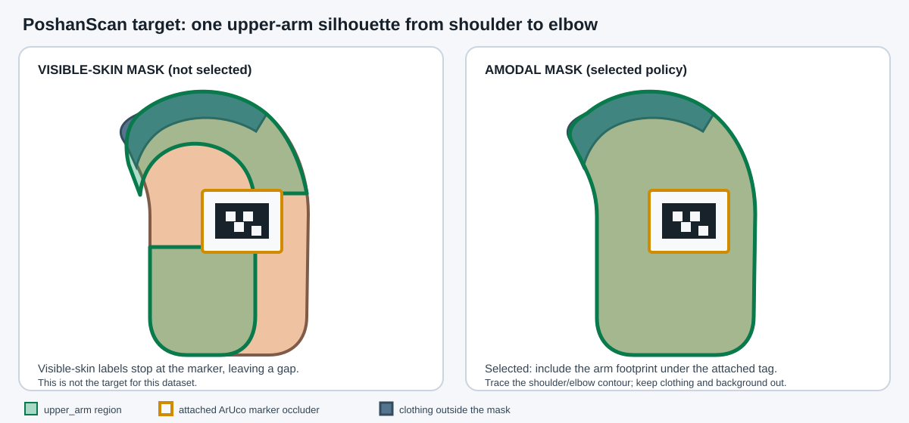

# PoshanScan upper-arm annotation guide



This guide defines the annotation target for the fixed PoshanScan image set. The illustration is schematic, not a dataset image or a mask proposal. Original images and labels remain unchanged until a reviewer edits and approves labels in CVAT.

## Annotation target and occlusion policy

Use exactly one class: **`upper_arm`**, class ID **`0`**. When the shoulder and elbow are visible, annotate the anatomical upper arm between those contours. If the image frame cuts the arm before the elbow, annotate only the visible upper-arm region and clip the polygon at the image boundary. Follow the actual outer contour; do not use a rectangle or generic oval. Do not include the forearm, hand, torso, clothing, background, ArUco marker pixels as a separate object, or unrelated objects.

### Selected target: amodal under the attached ArUco marker

The chosen target is an **amodal upper-arm region with respect to the attached ArUco marker**. The marker is attached to the arm and temporarily hides part of the arm surface. Draw one anatomically plausible upper-arm silhouette that continues underneath the marker. Do not create a rectangular hole, notch, split, or second instance to represent the marker. Keep the outer polygon on the actual arm boundary; if the marker overlaps an outer edge, infer only the hidden portion that is supported by the visible contour immediately around it. Never expand the mask to the marker's full rectangle if part of that rectangle lies outside the plausible arm silhouette.

This is different from **visible-skin segmentation**, which labels only skin pixels visible in the image and leaves a gap under the marker. Visible-skin is not the target around the marker. At an image-frame crop, however, the target is the visible intersection of the arm with the image; the polygon ends at the frame because pixels outside the image cannot be annotated.

### Approved policy for arms cropped by the image frame

For an image cropped before the elbow, label only the upper-arm area visible in the image. Clip the polygon exactly to the frame boundary. Do not extend it toward an estimated elbow, recreate hidden anatomy, or reject an otherwise clear visible portion solely because the elbow is out of frame. Continue to apply the amodal-under-marker rule to any visible attached marker. This frame-crop policy changes the target from a complete shoulder-to-elbow region to a partial visible region for those examples. A frame-truncated image cannot supply a reliable shoulder-to-elbow midpoint for MUAC placement by itself.

The amodal rule is deliberately limited to the attached marker. Clothing, hands, the torso, other objects, and other occluders remain excluded. Do not infer arm pixels beneath clothing or through unrelated occluders. If clothing or framing hides the shoulder/elbow boundary so that a reliable upper-arm outline cannot be drawn, flag the image for adjudication instead of guessing.

### Anatomical boundary rules

1. **Shoulder/proximal end:** trace the outer deltoid/upper-arm contour where it meets the shoulder and torso. Do not include the neck, chest, or torso. If the shoulder is covered by clothing, follow exposed skin only and flag an ambiguous boundary.
2. **Elbow/distal end:** when visible, stop at the elbow joint/crease, following the arm contour and excluding the forearm. In a bent arm, use the elbow crease and contour to separate upper arm from forearm; do not follow the whole bent limb as one region. If the frame crops the arm before the elbow, stop at the exact image boundary and do not infer the unseen elbow.
3. **Side contours:** follow the actual silhouette in the source image. Keep sleeves, loose fabric, hair, marker extensions beyond the arm, and background outside the mask.
4. **Marker:** include the inferred arm area beneath the attached marker, using a smooth bridge consistent with the arm's visible shape. Do not trace the tag's printed border as the arm boundary.
5. **Instances:** label the designated measurement subject's upper arm(s). If both of that subject's arms are visible and within scope, label each separately. Do not label background people, incidental hands/forearms, or unrelated objects. Do not create multiple same-class polygons for separate visible pieces of one arm around the marker. If the intended subject is ambiguous, flag the image for adjudication.
6. **Unclear examples:** flag the image for human adjudication if the visible shoulder/outer contour cannot be located reliably or the intended subject is unclear. A frame crop before the elbow is allowed under the rule above. Do not make up a mask. Record any eventual exclusion and reason in the annotation review log; do not move the image to another split.

## Visible-skin versus amodal: interpretation and limitations

For a complete image, the selected mask represents the projected 2D shoulder-to-elbow region, including the small part inferred beneath the attached marker. For a frame-truncated image, it represents only the visible intersection of that region with the image. No image pixels reveal the exact surface hidden by the marker, so annotators must use a consistent, conservative continuation of the neighboring contour. This adds annotation uncertainty and teaches the model to infer an arm region beneath a marker from surrounding visual context. It does not establish the hidden surface's true shape or recover anatomy outside the frame.

Ultralytics YOLO instance-segmentation labels store one normalized polygon outline per object row. They do not encode a separate visible mask plus an amodal mask, or a semantic occlusion map. A standard single outer polygon is therefore suitable for a simple silhouette bridged beneath the marker, but the format cannot express uncertainty in the hidden area. Keep the marker attached in the image, but include the arm footprint under it in the target. A polygon row is an instance, so a second same-class polygon would be interpreted as another instance, not as a hole or continuation.

This model's mask is a localization/shape cue for the downstream pipeline, not a direct measurement of arm circumference. A 2D silhouette does not by itself provide the anatomical cross-sectional circumference used for MUAC. Keep the downstream MUAC calculation separately calibrated and validated.

## Review status for the current fixed split

The existing 84/24/12 split and seed 2026 are frozen during this annotation review. Do not run `split_dataset.py`, regenerate lists, change the seed, or move a sample between partitions. A reviewed training subset may quarantine unresolved images while retaining each included image's existing partition; its included counts will be lower than 84/24/12. The original 131 image files stay in `dataset/images/`; the current 120 split images and labels remain in their existing folders. Review previews are aids only and are not labels.

Open `results/annotation_review/amodal_policy_review.md` and `results/annotation_review/amodal_correction_queue.csv` for image-specific findings. Review the native-resolution pages in `results/annotation_review/original_resolution/native_crop_pages/`; the full-frame current-label overlays are in `results/annotation_review/original_resolution/before/`. The geometry audit is `results/annotation_review/polygon_geometry_audit.csv`.

## CVAT annotation workflow

Use the existing PoshanScan CVAT task/export containing the 120 images from the current fixed split. If you need to recreate the task, upload only those fixed-split image files listed in the existing split lists, and add exactly one label named `upper_arm` with shape **Polygon**. Do not call the split-generation script as part of task setup.

For each image:

1. Open the original image at full resolution. Trace the shoulder-to-elbow outer contour when both ends are visible; if the frame crops the arm before the elbow, trace only the visible upper-arm region and end at the frame.
2. Continue a single amodal arm silhouette beneath the attached marker. Do not leave a marker-shaped hole or split the arm into separate polygons.
3. Exclude clothing, torso, background, forearm, hand, marker parts outside the arm silhouette, and unrelated objects.
4. Check the shoulder and elbow when visible. At a frame crop, follow the exact frame boundary without inventing the unseen elbow.
5. Inspect the polygon for self-crossings, spikes, accidental islands, and points that leak into clothing or background. Flag uncertain images for adjudication.
6. Save the task and have a second reviewer compare each approved polygon with the original image and this policy.

## Export and import annotations

In CVAT, choose **Actions → Export task dataset → Ultralytics YOLO Segmentation 1.0**. The export should contain the `upper_arm` class and normalized polygon rows in text files under `labels/`. See the [CVAT Ultralytics YOLO format guide](https://docs.cvat.ai/docs/manual/advanced/formats/format-yolo-ultralytics/) and [Ultralytics segmentation dataset format](https://docs.ultralytics.com/datasets/segment/).

Import only after a human has approved the CVAT task. Save the export archive separately; the import utility is designed to protect existing label files unless `--overwrite` is explicitly supplied. Keep a backup of the original labels before approving any replacement.

```powershell
cd "D:\minor project complete\poshanscan\ml-service"
python scripts/import_cvat_annotations.py --archive "C:\path\to\cvat-export.zip"
python scripts/validate_annotations.py
```

YOLO segmentation rows use this form:

```text
0 x1 y1 x2 y2 x3 y3 ...
```

Coordinates are normalized to `[0, 1]`. Every row must have class ID `0`, an even number of coordinate values, at least three distinct points, and finite in-range values. Polygons must also be simple, anatomically plausible, and reviewed against the image; numeric validation alone cannot establish annotation correctness. Verify image/label basenames and inspect the final overlays. Do not change the fixed split while importing labels.

## Annotation approval gate

For the complete 120-image dataset, do not start training until all unresolved annotations are corrected or explicitly excluded, validation passes, overlays are reviewed, and the frozen 84/24/12 source split is verified. A separately audited quarantine subset may be trained only when its selected image-label pairs pass preflight, the embedded manifest proves the 2026 source assignments and duplicate-group isolation, and all excluded items remain out of the training ZIP. Training on a small AI-generated subset is exploratory and does not establish clinical performance.
